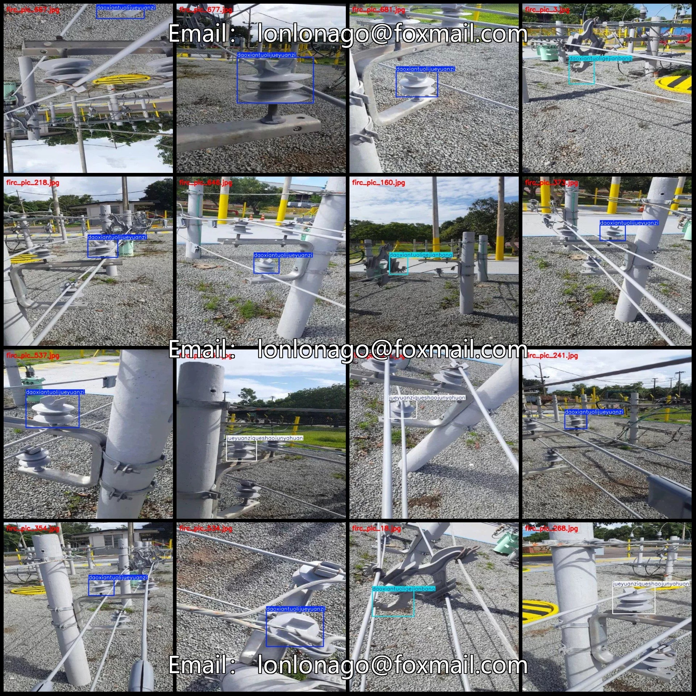
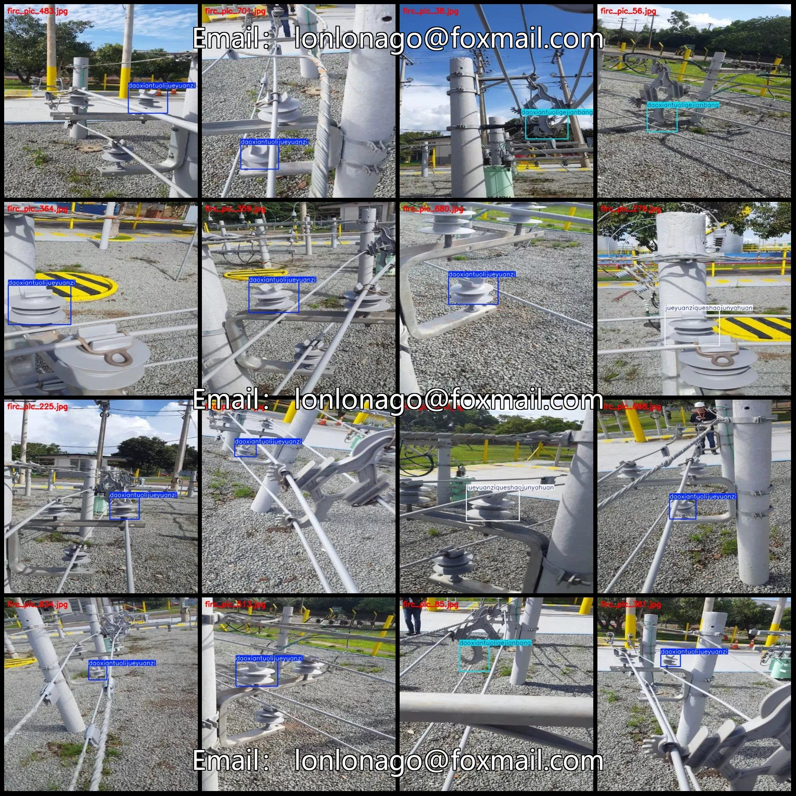
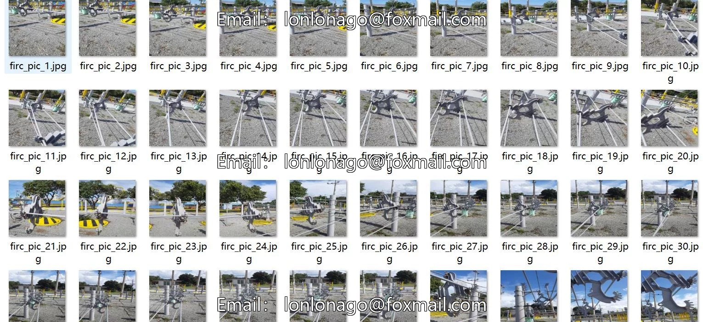
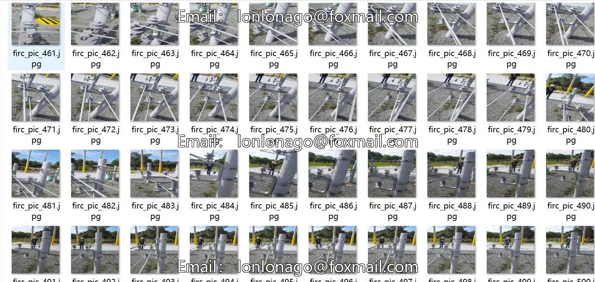
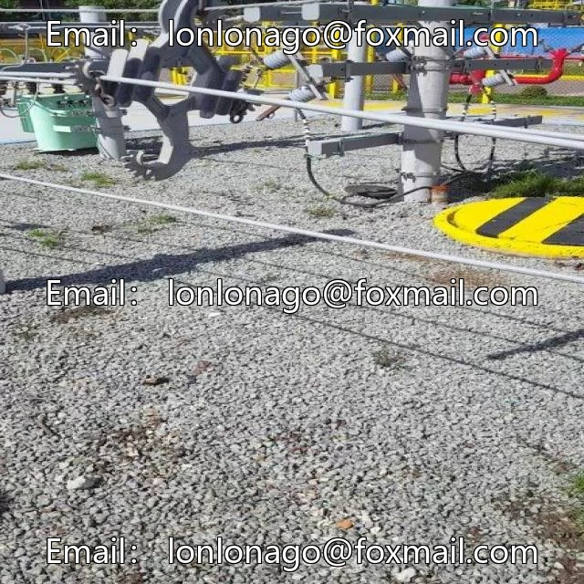
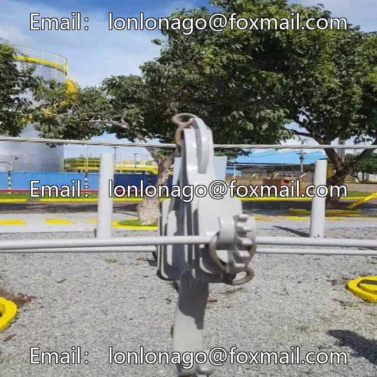
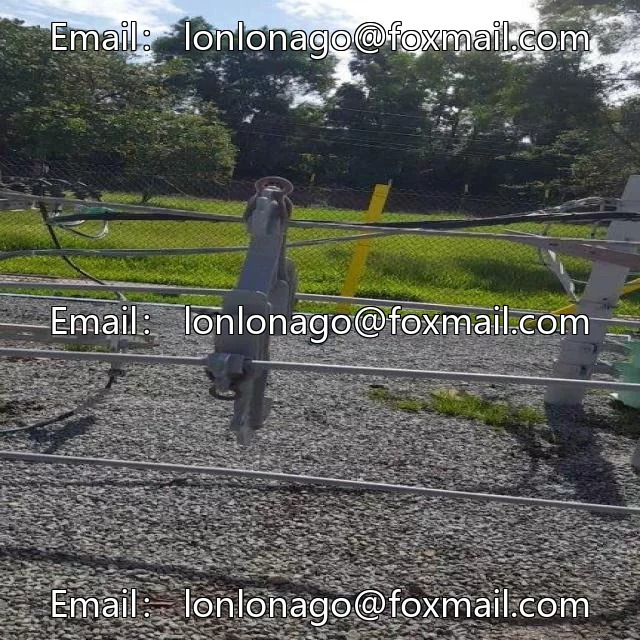

# Power scenario: data set for detecting the loss of insulator supports and missing even-voltage rings on power transmission line conductors

## Body

Power Scene Wiring Data Set: 707 Images (Pascal VOC+YOLO format) for 3 Categories

Warm Reminder: Due to the dataset's replicability, please confirm compliance with requirements before purchasing.

Note: The dataset is captured from different angles of three scene categories. Since actual data is not available, it is a simulated scenario.
Dataset Format: Pascal VOC format + YOLO format (txt file without split path, only containing jpg images and corresponding VOC format xml files and yolo format txt files)
Number of Images (JPG File Count): 707
Number of Annotations (XML File Count): 707

Number of annotations (number of txt files): 707
Number of annotation categories: 3
Annotation category names (note that the order in yolo format does not correspond to this, but is based on the classes.txt in the labels folder): ["daoxiantuoligejianbang", "daoxiantuolijueyuanzi", "jueyuanziqueshaojunyahuan
Corresponding Chinese category names: ["Wire Detached from Spacer Bar", "Wire Detached from Insulator", "Insulator Short of Dielectric Ring"]
Number of boxes per category
For "daoxiantuoligejianbang": 180

Number of frames = 355
Number of frame categories = 172
Total number of frames: 707
Number of images per category
Number of images in daoxiantuoligejianbang = 180
Number of images in daoxiantuolijueyuanzi = 355
Number of images in jueyuanziqueshaojunyahuan = 172
Image resolution: 640x640
Labeling tool used: labelImg
Labeling rules: Draw a rectangle around the category.

Important Notice: The dataset does not have separate training, validation, and test sets; you need to partition them yourself.
Special : This dataset does not guarantee the accuracy of the trained models or weight files.

## Images

## Payment

Here is a pay link on Stripe ( https://buy.stripe.com/3cs8yP7sY87d0vu9AB ). Please contact me lonlonago@foxmail.com after funding $89, and I will send you a complete data files , thank you!

